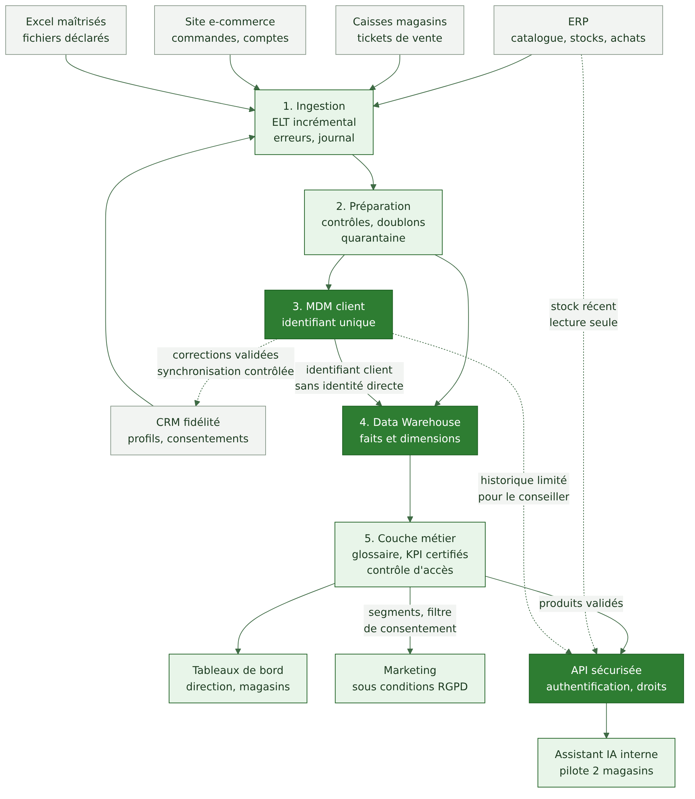
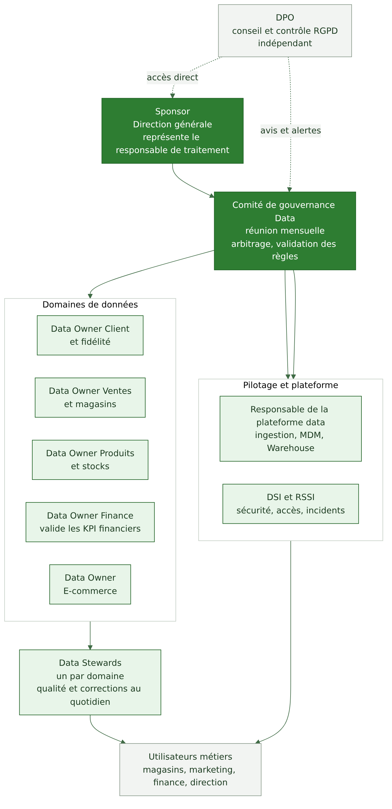
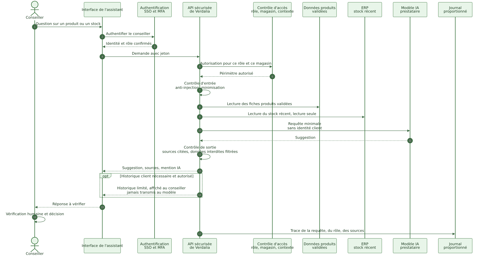

# Verdalia : une base commune pour les données d'un réseau de magasins

Projet académique DATE731 — Data Gouvernance et IA responsable. EPSI, Master 1. Sujet 1, groupe de trois étudiants. Travail de conception : aucun logiciel n'est développé dans ce dépôt.



## Table des matières

1. [Contexte du projet](#contexte-du-projet)
2. [Verdalia et sa problématique](#verdalia-et-sa-problématique)
3. [Objectifs](#objectifs)
4. [Chiffres clés](#chiffres-clés)
5. [Solution retenue](#solution-retenue)
6. [Composants de l'architecture](#composants-de-larchitecture)
7. [Les dix exigences](#les-dix-exigences)
8. [Gouvernance](#gouvernance)
9. [IA responsable](#ia-responsable)
10. [Comparaison des architectures](#comparaison-des-architectures)
11. [Organisation du groupe](#organisation-du-groupe)
12. [Chapitres du dossier](#chapitres-du-dossier)
13. [Livrables](#livrables)
14. [Instructions Git](#instructions-git)
15. [État réel d'avancement](#état-réel-davancement)

## Contexte du projet

Ce dépôt contient le dossier d'architecture Data demandé dans le module DATE731. Le sujet choisi est Verdalia : donner une base commune aux données d'un réseau de magasins. Le contenu repose sur l'énoncé transmis par le groupe ; le cahier des charges officiel et le support de cours n'étaient pas disponibles lors de la rédaction (voir [hypothèses et points à valider](docs/sources/HYPOTHESES_QUESTIONS.md)).

## Verdalia et sa problématique

Verdalia est une entreprise fictive de jardinage et d'équipement extérieur. Ses données vivent dans cinq sources qui ne se parlent pas : ERP, caisses, site e-commerce, CRM de fidélité et fichiers Excel. Les clients apparaissent en double, le chiffre d'affaires change selon les services, des exports clients circulent par e-mail et personne ne sait combien de temps les données doivent être conservées.

Problématique : comment donner à 14 magasins une base de données commune, fiable et conforme, qui supporte aussi un assistant IA interne, sans accumuler de technologies que Verdalia ne saurait pas gouverner ?

## Objectifs

1. Des tableaux de bord communs.
2. Une vision client unique.
3. Des indicateurs financiers cohérents.
4. Une meilleure utilisation des données de fidélité.
5. Un assistant IA interne testé dans deux magasins.
6. Une gestion responsable et conforme des informations clients.

## Chiffres clés

Données de l'énoncé.

| Indicateur | Valeur |
|---|---|
| Magasins | 14 |
| Salariés | 520 |
| Chiffre d'affaires | 190 M€ |
| Clients fidélisés | environ 600 000 |
| Profils CRM | 650 000 |
| Références catalogue | 18 000 |
| Mouvements de stock | 2 millions par an |
| Tickets de caisse | 6 millions par an |
| Commandes e-commerce | 400 000 par an |

## Solution retenue

Une architecture centralisée et modulaire : un Data Warehouse, un référentiel client MDM et une API sécurisée pour l'assistant IA. Décision formelle : [ADR-001](docs/adr/ADR-001-architecture-cible.md).

Points clés : un seul calcul du chiffre d'affaires validé par la direction financière ; un identifiant client unique ; un Warehouse pseudonymisé ; une IA qui n'accède jamais directement aux données ; une trajectoire de douze mois avec jalons à 6 et 12 mois.

## Composants de l'architecture

| Composant | Rôle |
|---|---|
| Ingestion | extraction incrémentale des sources, gestion des erreurs, journal |
| Préparation | contrôles de format, doublons, cohérence ; quarantaine ; zone brute à durée limitée |
| MDM client | identifiant unique, rapprochement, revue humaine des cas douteux, fusion réversible |
| Data Warehouse | modèle en étoile : dimensions client, produit, magasin, date ; faits ventes et stocks |
| Couche métier | glossaire, KPI certifiés, contrôle d'accès, traçabilité |
| Consommation | tableaux de bord, marketing sous conditions RGPD, assistant IA via API |

Détails : [architecture cible](docs/04-architecture-cible.md) et [modèle du Warehouse](docs/architecture/data-warehouse-modele.md).

## Les dix exigences

| ID | Exigence | Réponse en bref | Détail |
|---|---|---|---|
| EX-01 | Vue unique et fiable du client | MDM, identifiant unique | [fiche](docs/tracabilite/exigences.md#ex-01--vue-unique-et-fiable-du-client) |
| EX-02 | Définitions communes des KPI | glossaire, KPI certifiés | [fiche](docs/tracabilite/exigences.md#ex-02--définitions-communes-des-kpi) |
| EX-03 | Responsable pour chaque jeu de données | Data Owners et Stewards | [fiche](docs/tracabilite/exigences.md#ex-03--responsable-pour-chaque-jeu-de-données) |
| EX-04 | Gestion RGPD des données clients | registre, bases légales, AIPD | [fiche](docs/tracabilite/exigences.md#ex-04--gestion-rgpd-des-données-clients) |
| EX-05 | Traçabilité de chaque indicateur | lineage de bout en bout | [fiche](docs/tracabilite/exigences.md#ex-05--traçabilité-de-chaque-indicateur) |
| EX-06 | Droits d'accès par profil | accès par rôle, moindre privilège | [fiche](docs/tracabilite/exigences.md#ex-06--droits-daccès-par-profil) |
| EX-07 | Qualité minimale des données | indicateurs, quarantaine | [fiche](docs/tracabilite/exigences.md#ex-07--qualité-minimale-des-données) |
| EX-08 | Encadrement des données de l'IA | API intermédiaire | [fiche](docs/tracabilite/exigences.md#ex-08--encadrement-des-données-de-lassistant-ia) |
| EX-09 | Fournisseur externe et réversibilité | contrat et découplage | [fiche](docs/tracabilite/exigences.md#ex-09--fournisseur-externe-et-réversibilité) |
| EX-10 | Trajectoire à 6 et 12 mois | 4 phases, 4 jalons | [fiche](docs/tracabilite/exigences.md#ex-10--trajectoire-avec-jalons-à-6-et-12-mois) |

Matrice complète : [09 Matrice de traçabilité](docs/09-matrice-tracabilite.md).

## Gouvernance



Sponsor (direction générale), comité de gouvernance Data, Data Owners par domaine, Data Stewards, DSI et RSSI, DPO, responsable de la plateforme data, utilisateurs métiers. Matrice RACI de onze activités avec un seul A par ligne ; politique de classification en quatre niveaux. Voir [05 Gouvernance](docs/05-gouvernance-raci.md).

## IA responsable



L'assistant n'a jamais d'accès direct au Warehouse ni au CRM. Il passe par une API qui authentifie, autorise, minimise, filtre et journalise. Le stock récent vient de l'ERP en lecture seule. L'historique client limité n'est pas transmis au modèle. Le conseiller vérifie chaque suggestion. Analyse AI Act préliminaire, sans conclusion. Voir [06 RGPD et IA responsable](docs/06-rgpd-ia-responsable.md).

## Comparaison des architectures

Notes de 1 à 5 (qualitatives), quatre jeux de pondérations. Calcul reproductible : `python3 scripts/score_architectures.py`.

| Option | Poids du groupe | Poids égaux | Évolutivité privilégiée | Délai et coût privilégiés |
|---|---|---|---|---|
| Data Warehouse + MDM (retenu) | 4,20 | 4,10 | 3,90 | 4,20 |
| Hybride | 3,80 | 3,60 | 3,75 | 3,55 |
| Lakehouse | 3,30 | 3,10 | 3,65 | 2,95 |
| Data Lake | 2,45 | 2,50 | 2,75 | 2,50 |
| Data Mesh | 2,30 | 2,10 | 2,90 | 1,95 |

Méthode et limites : [comparaison](docs/architecture/comparaison-architectures.md).

## Organisation du groupe

| Membre | Rôle | Branche | Exigences |
|---|---|---|---|
| Personne 1 | Analyse et données | `feat/analyse-donnees` | EX-01, EX-07 |
| Personne 2 | Architecture et déploiement | `feat/architecture-trajectoire` | EX-02, EX-05, EX-09, EX-10 |
| Personne 3 | Gouvernance et conformité | `feat/gouvernance-rgpd-ia` | EX-03, EX-04, EX-06, EX-08 |

Travail collectif : validation de l'architecture, relecture, matrice de traçabilité, conclusion, IAgraphie, présentation orale. Détails : [répartition](organisation/REPARTITION.md), [tâches](organisation/TACHES.md).

## Chapitres du dossier

| N° | Chapitre |
|---|---|
| 00 | [Synthèse exécutive](docs/00-synthese-executive.md) |
| 01 | [Contexte et besoins](docs/01-contexte-besoins.md) |
| 02 | [Cartographie des données](docs/02-cartographie-donnees.md) |
| 03 | [Cycle de vie des données](docs/03-cycle-vie-donnees.md) |
| 04 | [Architecture cible](docs/04-architecture-cible.md) |
| 05 | [Gouvernance et RACI](docs/05-gouvernance-raci.md) |
| 06 | [RGPD et IA responsable](docs/06-rgpd-ia-responsable.md) |
| 07 | [Risques et mesures](docs/07-risques-mesures.md) |
| 08 | [Trajectoire sur 12 mois](docs/08-trajectoire.md) |
| 09 | [Matrice de traçabilité](docs/09-matrice-tracabilite.md) |
| 10 | [Conclusion](docs/10-conclusion.md) |

Annexes : [décisions d'architecture](docs/adr/ADR-001-architecture-cible.md), [diagrammes](docs/diagrammes/README.md), [bibliographie](docs/sources/BIBLIOGRAPHIE.md), [IAgraphie](docs/sources/IAGRAPHIE.md), [hypothèses et questions](docs/sources/HYPOTHESES_QUESTIONS.md).

## Livrables

| Livrable | Emplacement |
|---|---|
| Dossier Word modifiable | [livrables/dossier/DATE731_Verdalia_Dossier_Architecture.docx](livrables/dossier/DATE731_Verdalia_Dossier_Architecture.docx) |
| Présentation de 15 minutes | [livrables/soutenance/DATE731_Verdalia_Soutenance.pptx](livrables/soutenance/DATE731_Verdalia_Soutenance.pptx) |
| Script oral | [presentation/SCRIPT_ORAL.md](presentation/SCRIPT_ORAL.md) |
| Questions du jury | [presentation/QUESTIONS_JURY.md](presentation/QUESTIONS_JURY.md) |
| Notes des orateurs | [presentation/NOTES_ORATEURS.md](presentation/NOTES_ORATEURS.md) |
| Rapport de validation | [organisation/RAPPORT_VALIDATION.md](organisation/RAPPORT_VALIDATION.md) |
| Checklist de rendu | [organisation/CHECKLIST_RENDU.md](organisation/CHECKLIST_RENDU.md) |

Le Markdown est la source de référence ; le Word et le PowerPoint se régénèrent avec les scripts du dossier `scripts/`.

## Instructions Git

Guide complet : [organisation/GUIDE_GIT.md](organisation/GUIDE_GIT.md). Résumé :

```bash
git clone <url-du-depot>
cd date731-verdalia-gouvernance-data
git switch feat/analyse-donnees          # ou votre branche
# modifier, puis :
git add <fichiers>
git commit -m "docs(data): décrire la modification"
git push -u origin feat/analyse-donnees
# ouvrir une Pull Request vers main, relue par un autre membre
```

Convention de commit : `type(portée): description`. Règles de collaboration : [CONTRIBUTING.md](CONTRIBUTING.md).

## État réel d'avancement

Au 6 novembre 2026 :

- Un premier jet complet de tous les documents est généré avec une IA (voir [IAgraphie](docs/sources/IAGRAPHIE.md)) ; il n'est pas encore relu ni approprié par les étudiants.
- Les huit diagrammes sont rendus et validés (SVG et PNG).
- Les scripts `check_raci.py` et `check_links.py` ont été exécutés ; résultats dans le [rapport de validation](organisation/RAPPORT_VALIDATION.md).
- Les sources juridiques n'ont été lues que par extraits : à vérifier sur EUR-Lex, Légifrance et cnil.fr.
- Le cahier des charges officiel et le support de cours n'ont pas été exploités.
- Les prénoms des trois membres et les dates du calendrier sont à compléter.

Aucun test logiciel n'existe : le projet est un travail de conception.
