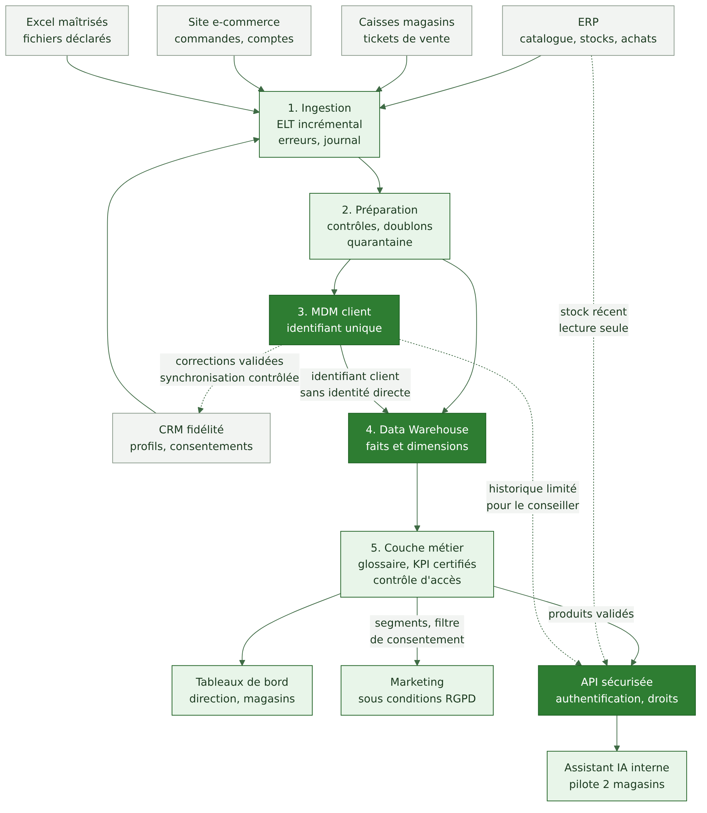

# Synthèse exécutive

Projet DATE731 — Verdalia : donner une base commune aux données d'un réseau de magasins.

## Le problème en quelques lignes

Verdalia (14 magasins, 520 salariés, 190 M€ de chiffre d'affaires) travaille avec cinq sources de données qui ne se parlent pas : ERP, caisses, site e-commerce, CRM fidélité et fichiers Excel. Conséquences décrites dans l'énoncé : clients présents plusieurs fois, chiffres d'affaires différents selon les services, exports clients envoyés par e-mail, responsabilités floues et durées de conservation inconnues. La direction souhaite des tableaux de bord communs, une vision client unique, des indicateurs financiers cohérents, une meilleure valorisation de la fidélité et un assistant IA interne testé dans deux magasins, le tout dans un cadre conforme au RGPD.

## La solution proposée

Nous proposons une architecture centralisée et modulaire en six étapes : ingestion, préparation, référentiel client (MDM), Data Warehouse, couche métier, consommation. L'assistant IA n'accède jamais directement aux données : il passe par une API sécurisée qui authentifie le conseiller, vérifie ses droits, filtre les données et journalise.

## Pourquoi ce choix

Les volumes de Verdalia sont modestes (6 millions de tickets, 2 millions de mouvements de stock et 400 000 commandes par an) et les données sont très structurées. Un Data Warehouse avec un MDM répond au besoin avec la complexité technique et organisationnelle la plus faible. La comparaison avec Data Lake, Lakehouse, Data Mesh et une approche hybride (chapitre 04 et ADR-001) place cette option en tête dans les quatre scénarios de pondération testés. L'écart se réduit quand on privilégie l'évolutivité : c'est la principale limite assumée, et elle fait l'objet de conditions de réexamen.

## Ce que le dossier apporte

- Les dix exigences EX-01 à EX-10 sont traitées une par une (matrice dans le chapitre 09).
- Une gouvernance réaliste avec rôles, matrice RACI (un seul A par ligne) et politique de classification.
- Une analyse RGPD distinguant les finalités, avec des durées de conservation clairement présentées comme obligation légale, recommandation CNIL ou proposition interne.
- Une analyse préliminaire AI Act sans conclusion définitive.
- Une trajectoire de 12 mois en quatre phases avec jalons à 6 et 12 mois.

## Limites à connaître

Le cahier des charges officiel et le support de cours n'étaient pas disponibles lors de la rédaction : le dossier repose sur l'énoncé fourni par le groupe. Les seuils de qualité, les durées internes, les charges de travail et les notes de comparaison sont des hypothèses du groupe, listées dans `docs/sources/HYPOTHESES_QUESTIONS.md`. Aucun budget officiel n'est fourni.

Suite : [01 Contexte et besoins](01-contexte-besoins.md).
