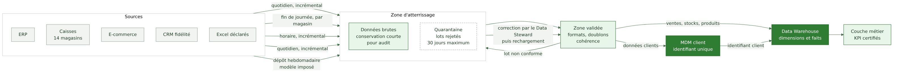

# 02 — Cartographie des données

Responsable : Personne 1. Détails complémentaires : [classification des données critiques](donnees/classification-donnees-critiques.md), [MDM client](donnees/mdm-client.md), [qualité des données](donnees/qualite-donnees.md).

## 2.1 Sources, domaines et propriétaires proposés

Les propriétaires (Data Owners) sont des propositions du groupe, à valider par la direction.

| Source | Domaine de données | Jeux de données principaux | Data Owner proposé | Data Steward proposé |
|---|---|---|---|---|
| ERP | Produits et stocks | catalogue, prix, achats, mouvements de stock | Direction achats et approvisionnement | Responsable catalogue |
| Caisses | Ventes magasins | tickets, lignes de ticket, moyens de paiement (type uniquement) | Direction commerciale et exploitation | Adjoint de magasin référent |
| E-commerce | E-commerce | commandes, comptes, navigation | Responsable e-commerce | Chef de produit web |
| CRM fidélité | Client et fidélité | profils, points, consentements | Direction marketing et relation client | Responsable CRM |
| Excel | Transverse | exports, suivis | Propriétaire du fichier déclaré | Steward du domaine concerné |
| Indicateurs financiers | Finance | CA, marge, panier moyen | Direction financière (DAF) | Contrôleur de gestion |

## 2.2 Familles de données

Une même donnée peut appartenir à plusieurs familles.

| Famille | Définition | Exemples |
|---|---|---|
| Opérationnelles | produites par l'activité quotidienne | tickets, commandes, mouvements de stock |
| De référence | décrivent des objets stables partagés | clients (MDM), produits, magasins, calendrier |
| Sensibles | à protéger fortement (personnelles, commerciales) | identité et coordonnées clients, consentements, marge |
| Stratégiques | pilotent les décisions | KPI financiers certifiés, prévisions |

## 2.3 Opérationnel et analytique

Distinction centrale pour l'assistant IA (détaillée au chapitre 04) :

- Données opérationnelles : état courant d'un système source (par exemple le stock d'un produit à l'instant T dans l'ERP). Elles changent à chaque minute et sont consultées en temps réel.
- Données analytiques : copies historisées et consolidées dans le Warehouse (par exemple les ventes par magasin et par jour). Elles sont recalculées par lots et servent à analyser, pas à décider d'un fait instantané.

## 2.4 Principaux flux

Voir [diagramme des flux](diagrammes/02-flux-donnees.png).

| Flux | Fréquence proposée | Mode | Justification |
|---|---|---|---|
| Caisses vers zone brute | fin de journée par magasin | lot incrémental | pas de besoin temps réel pour le pilotage |
| E-commerce vers zone brute | horaire | incrémental | suivi des commandes dans la journée |
| CRM vers zone brute | quotidien | incrémental | consentements à jour sous 24 h |
| ERP vers zone brute | quotidien | incrémental | catalogue et achats ; le stock courant pour l'IA reste lu en direct |
| Excel déclarés | hebdomadaire | dépôt avec modèle imposé | usage résiduel, contrôlé |

Ces fréquences sont des hypothèses du groupe à confirmer avec la DSI.

## 2.5 Excel : de l'usage sauvage à l'usage maîtrisé

Règles proposées : registre des fichiers déclarés (propriétaire, finalité, emplacement, durée), interdiction d'envoyer un export client par e-mail, remplacement par un accès libre-service aux tableaux de bord, exports tracés et pseudonymisés quand c'est possible, dépôt dans un espace partagé avec droits.

## 2.6 Questions ouvertes

Voir `docs/sources/HYPOTHESES_QUESTIONS.md` : explication de l'écart 650 000 / 600 000, nature des identifiants disponibles en caisse, présence de champs libres contenant des données sensibles.

Précédent : [01](01-contexte-besoins.md). Suite : [03 Cycle de vie](03-cycle-vie-donnees.md).
