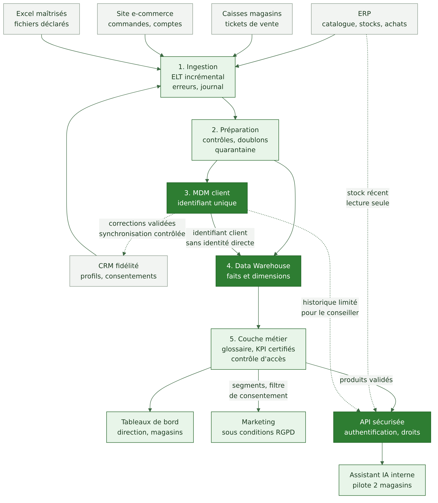
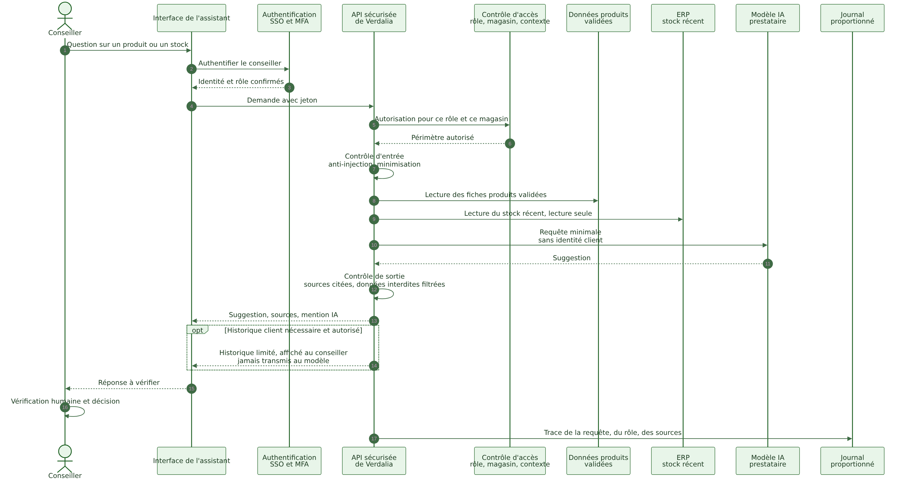
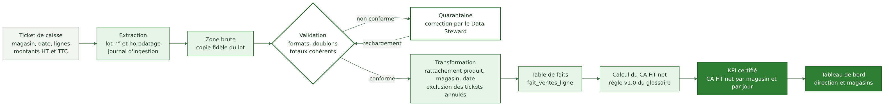

# 04 — Architecture cible

Responsable : Personne 2 (architecture et déploiement), validation collective. Décision formelle : [ADR-001](adr/ADR-001-architecture-cible.md).

## 4.1 Proposition

Architecture centralisée et modulaire : un Data Warehouse, un référentiel client MDM et une API sécurisée pour l'assistant IA. Nous la présentons comme la meilleure option pour ce contexte, et non comme une solution universelle ; la démonstration est dans la comparaison ci-dessous.

Légende : trait plein = flux de données vers l'aval ; trait pointillé = accès contrôlé ou synchronisation limitée. Aucune flèche ne renvoie de données du Warehouse vers les sources.

## 4.2 Composants

| Composant | Rôle | Choix de conception |
|---|---|---|
| Ingestion | récupérer les données des sources | extraction incrémentale quand la source le permet ; gestion des erreurs et relance ; journal de chaque lot |
| Préparation | rendre les données fiables | contrôles de format, doublons, cohérence ; quarantaine ; zone brute à durée limitée |
| MDM | identité client unique | voir [mdm-client](donnees/mdm-client.md) |
| Data Warehouse | consolider et historiser | modèle en étoile : dimensions client, produit, magasin, date ; faits ventes et mouvements de stock ; voir [modèle](architecture/data-warehouse-modele.md) |
| Couche métier | rendre les chiffres communs | glossaire, KPI certifiés, contrôle d'accès, traçabilité ; voir [KPI](architecture/kpi-et-lineage.md) |
| Consommation | usages | tableaux de bord direction et magasins, marketing sous conditions RGPD, assistant IA via API |

### ETL ou ELT

ETL transforme avant de charger ; ELT charge d'abord les données brutes puis transforme dans l'entrepôt. Nous retenons l'ELT pour la majorité des flux, car il garde la copie brute pour l'audit et simplifie le rechargement, avec des transformations écrites en SQL versionné. L'ETL reste pertinent pour masquer des données personnelles avant tout chargement (par exemple champs libres).

### Pseudonymisation dans le Warehouse (choix d'architecture)

Le Warehouse ne contient pas les coordonnées ni l'identité directe des clients : il porte l'identifiant client unique et des attributs d'analyse (tranche d'âge, code postal tronqué, ancienneté). La ré-identification passe par le MDM, accessible à un cercle restreint. Cela réduit l'impact d'un accès excessif aux tableaux de bord. Elle ne rend pas les données anonymes au sens du RGPD : elles restent des données personnelles. Voir [ADR-003](adr/ADR-003-pseudonymisation-warehouse.md).

## 4.3 Données analytiques et données opérationnelles

| | Données analytiques (Warehouse) | Données opérationnelles (temps réel) |
|---|---|---|
| Exemple | ventes par magasin sur 12 mois | stock d'un produit dans un magasin maintenant |
| Fraîcheur | veille (J-1) | quelques secondes à minutes |
| Source de vérité | Warehouse, après contrôles | ERP, CRM, caisses |
| Usage | analyse, pilotage, tableaux de bord | décision immédiate (conseil client) |
| Risque principal | chiffre périmé s'il est utilisé comme état courant | charge sur le système source, accès trop large |

Conséquence pour l'IA : la question « ce produit est-il en stock ? » est posée à l'ERP par l'API (lecture seule), pas au Warehouse, car une réponse de la veille serait trompeuse.

## 4.4 Assistant IA : architecture d'accès

Principes, détaillés dans [assistant-ia-api](architecture/assistant-ia-api.md) :

1. Le modèle n'a jamais d'accès direct au Warehouse, au MDM ni au CRM.
2. Authentification du conseiller (SSO avec authentification forte) puis autorisation selon rôle, magasin et contexte.
3. L'API assemble une requête minimale : fiches produits validées, stock récent lu à l'ERP, sans identité client.
4. L'historique client limité est affiché au conseiller séparément et n'est pas transmis au modèle, sauf exception formellement justifiée, validée par le DPO et tracée.
5. Contrôles d'entrée (injections de prompt) et de sortie (sources citées, données interdites filtrées).
6. Vérification humaine : la suggestion est une aide, la décision revient au conseiller.
7. Journalisation proportionnée, contrat avec garanties de confidentialité et de non-réutilisation, réversibilité.

## 4.5 Comparaison des architectures

Cinq options sont comparées : Data Warehouse centralisé avec MDM, Data Lake, Lakehouse, Data Mesh, approche hybride. Le détail des définitions et des justifications est dans [comparaison-architectures](architecture/comparaison-architectures.md).

Méthode : dix critères, pondération explicite du groupe (somme 100), notes ordinales de 1 à 5 (5 = le plus favorable à Verdalia). Les notes sont des appréciations qualitatives argumentées, pas des mesures. Pour éviter une conclusion fragile, quatre jeux de poids sont testés.

| Option | A. Poids du groupe | B. Poids égaux | C. Évolutivité privilégiée | D. Délai et coût privilégiés |
|---|---|---|---|---|
| Data Warehouse centralisé + MDM | 4,20 | 4,10 | 3,90 | 4,20 |
| Hybride (Warehouse + MDM + zone brute) | 3,80 | 3,60 | 3,75 | 3,55 |
| Lakehouse | 3,30 | 3,10 | 3,65 | 2,95 |
| Data Lake | 2,45 | 2,50 | 2,75 | 2,50 |
| Data Mesh | 2,30 | 2,10 | 2,90 | 1,95 |

Lecture : le Warehouse avec MDM arrive en tête dans les quatre scénarios, mais l'écart avec l'hybride et le Lakehouse devient faible si l'évolutivité domine. Le calcul est reproductible avec `scripts/score_architectures.py`.

## 4.6 Fournisseur et réversibilité (EX-09)

Voir [choix-fournisseur](architecture/choix-fournisseur.md) : critères de sélection, clauses contractuelles, plan de réversibilité.

## 4.7 Qualité, traçabilité et KPI

Les contrôles qualité sont décrits dans [qualité des données](donnees/qualite-donnees.md). La traçabilité d'un KPI de bout en bout est illustrée dans [kpi-et-lineage](architecture/kpi-et-lineage.md).

## 4.8 Évolution vers 28 magasins

Le modèle en étoile ajoute des magasins en ajoutant des lignes de dimension, sans refonte. La charge double environ (hypothèse linéaire) et reste modeste. Les points à revoir sont la fenêtre de chargement de fin de journée, la capacité de la file de revue MDM et la gouvernance (plus de Data Stewards). Si Verdalia ajoute de grands volumes non structurés (images, journaux de navigation fins), la zone brute pourra évoluer vers un Lakehouse : c'est une condition de réexamen de l'ADR-001.

Précédent : [03](03-cycle-vie-donnees.md). Suite : [05 Gouvernance et RACI](05-gouvernance-raci.md).
