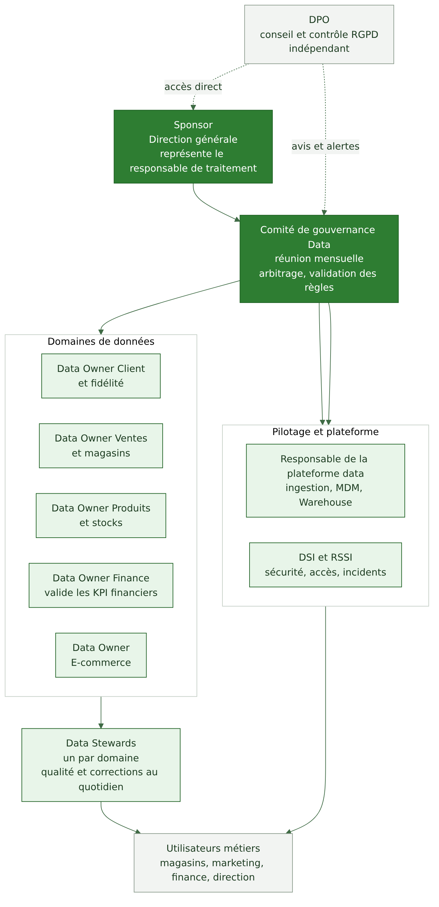

# 05 — Gouvernance et matrice RACI

Responsable : Personne 3 (gouvernance et conformité). Exigences : EX-03 et EX-06. Détails : [rôles](gouvernance/roles-et-definitions.md), [RACI](gouvernance/raci.md), [classification](gouvernance/politique-classification.md), [accès](gouvernance/politique-acces.md).

## 5.1 Organisation proposée

| Rôle | Mission principale | Qui (proposition) |
|---|---|---|
| Sponsor | porte le projet, arbitre, représente le responsable de traitement | Direction générale |
| Comité de gouvernance Data | valide règles, KPI, priorités et conformité ; réunion mensuelle | Sponsor ou délégué, plateforme data, DSI, DPO, Data Owners |
| Data Owners | décident des règles et des accès pour leur domaine | un par domaine : Client, Ventes, Produits, Finance, E-commerce |
| Data Stewards | appliquent les règles, corrigent la qualité, animent le glossaire | un par domaine |
| DSI et RSSI | sécurité, accès techniques, incidents | DSI |
| DPO | conseille, contrôle, point de contact des personnes et de la CNIL | DPO désigné |
| Responsable plateforme data | exploite l'ingestion, le MDM, le Warehouse, l'API | équipe data de la DSI |
| Utilisateurs métiers | utilisent les données dans le respect des règles, signalent les anomalies | magasins, marketing, finance, direction |

## 5.2 Quatre rôles souvent confondus

| Rôle | Nature | Ce qu'il fait | Ce qu'il ne fait pas |
|---|---|---|---|
| Responsable de traitement | juridique (RGPD art. 4 et 24) : Verdalia, personne morale | détermine finalités et moyens, répond de la conformité | ne se délègue pas, même si des tâches se délèguent |
| Data Owner | métier | décide des règles d'usage, de qualité et d'accès d'un domaine | ne corrige pas les données au quotidien |
| Data Steward | opérationnel | veille à la qualité, corrige, tient le glossaire | ne décide pas seul des finalités |
| DPO | conseil et contrôle (art. 37 à 39) | informe, conseille, contrôle, coopère avec la CNIL | ne décide pas des traitements et ne reçoit pas d'instruction sur ses missions |

## 5.3 Matrice RACI

R = réalise, A = rend compte et décide (un seul par ligne), C = consulté, I = informé.

| Activité | Sponsor | Comité | Data Owner | Data Steward | Resp. plateforme | DSI et RSSI | DPO | Utilisateurs |
|---|---|---|---|---|---|---|---|---|
| Définition des KPI | I | C | A | R | C | I | I | C |
| Création d'un jeu de données | I | I | A | R | R | C | C | I |
| Correction des erreurs | I | I | C | A | R | I | I | C |
| Fusion de fiches clients | I | I | C | A | R | I | C | I |
| Gestion des droits | I | I | A | C | R | R | C | I |
| Modification des règles de conservation | C | A | C | C | R | C | R | I |
| Gestion des consentements | I | I | A | R | R | I | C | I |
| Gestion des incidents | C | I | C | I | R | A | R | I |
| Validation des données IA | I | I | A | R | R | C | C | I |
| Choix du prestataire externe | A | C | C | I | R | R | C | I |
| Validation du déploiement | A | R | C | I | R | C | C | I |

Choix expliqués dans [raci](gouvernance/raci.md). Une vérification automatique (un seul A par ligne) est effectuée par `scripts/check_raci.py`.

## 5.4 Classification

Quatre niveaux : Public, Interne, Confidentiel, Personnel ou sensible. Règles dans [politique-classification](gouvernance/politique-classification.md).

## 5.5 Accès par profil (EX-06)

Principe du moindre privilège, rôles et périmètres (magasin, domaine), revues d'accès périodiques, journalisation. Détails dans [politique-acces](gouvernance/politique-acces.md).

Précédent : [04](04-architecture-cible.md). Suite : [06 RGPD et IA responsable](06-rgpd-ia-responsable.md).
