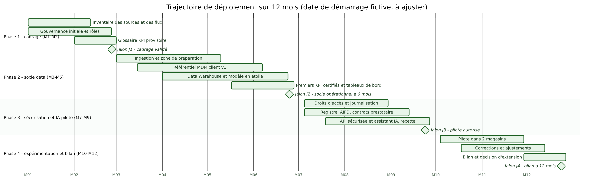

# 08 — Trajectoire sur douze mois

Responsable : Personne 2. Exigence : EX-10. Le calendrier est une proposition. Les dates du diagramme sont fictives (démarrage supposé en janvier 2027) et à ajuster.

## 8.1 Phases

| Phase | Mois | Objectif |
|---|---|---|
| 1. Cadrage | 1 à 2 | connaître les sources, nommer les rôles, fixer les définitions provisoires |
| 2. Socle data | 3 à 6 | ingestion, MDM v1, Warehouse, premiers KPI certifiés |
| 3. Sécurisation et IA pilote | 7 à 9 | accès, conformité, API, assistant prêt à tester |
| 4. Expérimentation et bilan | 10 à 12 | pilote dans 2 magasins, corrections, décision d'extension |

## 8.2 Détail par phase

### Phase 1 (mois 1 à 2)

| Élément | Contenu |
|---|---|
| Livrables | inventaire des sources et flux, mesure initiale de qualité, désignation des Data Owners et Stewards, comité installé, glossaire KPI provisoire, registre Excel |
| Dépendances | accès aux sources, disponibilité des métiers |
| Responsables | Sponsor, Responsable plateforme data, DPO |
| Critères d'acceptation | 100 % des sources recensées ; rôles nommés par écrit ; mesure de qualité réalisée ; KPI prioritaires définis en version provisoire |
| Jalon J1 (fin mois 2) | cadrage validé par le comité |
| Condition de passage | validation du sponsor et des Data Owners ; accès aux données obtenus pour les sources prioritaires |

### Phase 2 (mois 3 à 6)

| Élément | Contenu |
|---|---|
| Livrables | pipelines d'ingestion avec journal, zone de quarantaine, MDM v1, Warehouse en étoile, CA, marge et panier moyen certifiés, tableaux de bord direction et magasins, AIPD du MDM |
| Dépendances | rôles nommés, accès, validation des KPI par la DAF |
| Responsables | Responsable plateforme data, Data Owner Finance, Data Steward Client |
| Critères d'acceptation | cohérence caisses et Warehouse sous le seuil (0,1 % par magasin et par jour, hypothèse) ; CA unique validé par la DAF ; doublons estimés en baisse mesurée ; traçabilité d'un KPI démontrée |
| Jalon J2 (mois 6) | socle opérationnel, premiers KPI certifiés |
| Condition de passage | validation de la DAF ; avis du DPO sur le MDM ; recette signée |

### Phase 3 (mois 7 à 9)

| Élément | Contenu |
|---|---|
| Livrables | matrice d'accès appliquée, journalisation, registre des traitements, AIPD, contrat prestataire avec clauses (réversibilité, non-réutilisation), API sécurisée, tests d'injection, formation des conseillers pilotes, charte d'usage |
| Dépendances | choix du prestataire (RACI : Sponsor), conformité du socle |
| Responsables | DSI et RSSI, DPO, Responsable plateforme data |
| Critères d'acceptation | tests de sécurité sans faille critique non corrigée ; contrat signé ; AIPD validée ou mesures adoptées ; revue des accès faite |
| Jalon J3 (fin mois 9) | pilote autorisé |
| Condition de passage | go du Sponsor après avis du DPO et du RSSI |

### Phase 4 (mois 10 à 12)

| Élément | Contenu |
|---|---|
| Livrables | pilote dans 2 magasins, rapport d'évaluation (qualité des réponses, incidents, satisfaction), corrections, test de réversibilité, bilan à 12 mois, recommandation d'extension |
| Dépendances | J3 acquis, disponibilité des magasins pilotes |
| Responsables | Data Owner Produits, Responsable plateforme data, comité |
| Critères d'acceptation | aucun incident grave de confidentialité ; seuils d'acceptation de qualité fixés en phase 3 atteints ; test de remplacement du fournisseur réalisé |
| Jalon J4 (mois 12) | bilan et décision d'extension ou d'arrêt |
| Condition de passage | décision du Sponsor sur recommandation du comité |

## 8.3 Jalons demandés par l'exigence EX-10

À 6 mois : J2, socle opérationnel avec premiers KPI certifiés. À 12 mois : J4, pilote évalué et décision d'extension.

## 8.4 Charge indicative (estimation du groupe, non officielle)

Hypothèses : équipe data de la DSI de 3 personnes (un responsable de plateforme, un ingénieur de données, un analyste), Data Stewards à temps partiel, DPO et RSSI ponctuels. Unité : jours-personne.

| Phase | Plateforme data | Métiers (Owners et Stewards) | Conformité et sécurité | Total indicatif |
|---|---|---|---|---|
| 1 | 40 | 30 | 15 | 85 |
| 2 | 160 | 60 | 20 | 240 |
| 3 | 90 | 30 | 50 | 170 |
| 4 | 60 | 40 | 20 | 120 |

Total indicatif : environ 615 jours-personne. Ces chiffres sont des ordres de grandeur sans valeur officielle : ils dépendent de la complexité réelle des sources, de l'outil choisi et de l'expérience de l'équipe. Aucun montant en euros n'est donné car l'énoncé ne fournit ni budget ni tarifs ; un chiffrage nécessiterait des devis de plateformes et le coût journalier interne de Verdalia.

Scénarios de sensibilité : si la qualité des sources est médiocre (risque R05), la phase 2 peut augmenter de 25 % à 50 % (hypothèse) ; si les métiers sont peu disponibles (R04), le calendrier s'allonge plutôt que la charge.

## 8.5 Réalisme du calendrier

Le calendrier est volontairement progressif : les KPI financiers arrivent avant l'IA, car l'IA dépend d'un socle fiable et d'un cadre conforme. Le pilote n'ouvre que si J3 est franchi ; un retard de phase 2 décale d'autant J3 sans réduire les contrôles.

Précédent : [07](07-risques-mesures.md). Suite : [09 Matrice de traçabilité](09-matrice-tracabilite.md).
