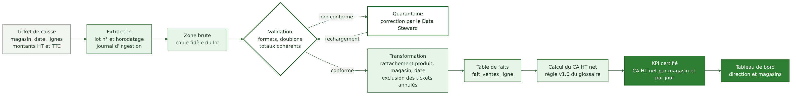

# KPI, glossaire et traçabilité

Responsable : Personne 2. Exigences : EX-02 et EX-05.

## Statut des définitions

Toutes les définitions ci-dessous sont provisoires, proposées par le groupe. Une définition ne devient officielle qu'après validation écrite de la direction financière (DAF), avec numéro de version et date d'application.

| KPI | Définition provisoire (v0.1) | Statut | Validateur | Questions à trancher |
|---|---|---|---|---|
| Chiffre d'affaires HT net | somme des ventes HT des magasins et du e-commerce, après remises, retours et annulations | provisoire | DAF | traitement des avoirs, des frais de livraison, des ventes en cours de livraison |
| Marge brute | CA HT net moins coût d'achat des produits vendus | provisoire | DAF | méthode de valorisation du coût (prix moyen pondéré ou autre), remises fournisseurs |
| Panier moyen | CA HT net divisé par le nombre de tickets ou commandes avec au moins une ligne vendue | provisoire | DAF | séparation magasin et e-commerce, tickets à zéro |
| Taux de rupture | part des références actives à stock nul au moment de la mesure | provisoire | Direction achats | liste des références actives |
| Part de ventes identifiées | ventes rattachées à un client identifié divisées par ventes totales | provisoire | Direction marketing | tickets sans carte |

Fiche de définition type : nom, formule, périmètre, sources, granularité, fréquence, propriétaire, validateur, version, date de validité, exemples de calcul, cas limites.

## Glossaire commun

Un glossaire unique, versionné dans le dépôt, définit les termes (client, client fidélisé, ticket, commande, magasin actif, référence active). Aucun KPI ne peut être publié sans entrée de glossaire.

## Contrôle de cohérence du chiffre d'affaires

Un seul calcul du CA, dans la couche métier. Toutes les restitutions lisent ce calcul. Les écarts avec les caisses sont contrôlés chaque jour par magasin (seuil d'alerte hypothétique de 0,1 %). Les anciens fichiers Excel de calcul sont retirés ou marqués non officiels.

## Exemple complet de lineage : le CA d'un magasin pour un jour donné

| Étape | Action | Métadonnée conservée | Responsable | Contrôle |
|---|---|---|---|---|
| 1. Ticket de caisse | vente enregistrée en magasin | identifiant du ticket, magasin, date, lignes | magasin | totalisation de la caisse |
| 2. Extraction | export de fin de journée | numéro de lot, horodatage, nombre de lignes | plateforme data | nombre de tickets attendus |
| 3. Zone brute | copie fidèle | empreinte du lot | plateforme data | comparaison avec l'extraction |
| 4. Validation | formats, doublons, totaux | résultat par règle | plateforme data | seuil de rejet |
| 4 bis. Quarantaine | lot non conforme | motif du rejet | Data Steward Ventes | délai de correction |
| 5. Transformation | rattachement produit, magasin, date ; exclusion des annulés | version du script | plateforme data | revue du code |
| 6. Table de faits | ligne de vente historisée | date de chargement | plateforme data | rapprochement avec le total des caisses |
| 7. Calcul du CA | application de la règle v1.0 | version de la règle, date de calcul | Data Owner Finance | contrôle de cohérence |
| 8. Tableau de bord | affichage du KPI certifié | indicateur « certifié » et date de mise à jour | utilisateurs métiers | alerte si donnée en retard |

Pour tout chiffre affiché, un clic ou une fiche doit répondre : de quels tickets vient-il, avec quelle règle, quand a-t-il été calculé, par qui est-il validé.

## Mise en œuvre de la traçabilité

Un catalogue de métadonnées techniques recense les tables, colonnes et transformations ; les identifiants de lot circulent de l'ingestion au KPI. Le choix d'un outil de catalogue est volontairement non figé : un journal structuré et des conventions de nommage suffisent pour la première version.
