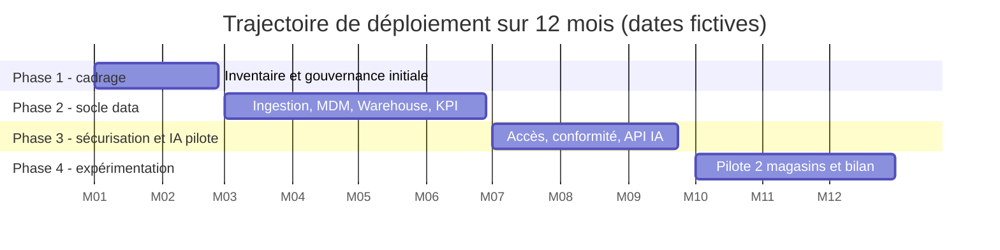

# Diagrammes

Sources Mermaid (`.mmd`), exports SVG et PNG générés par `bash scripts/build_diagrams.sh`. Charte : vert foncé, vert naturel, blanc, gris clair. Les blocs ci-dessous s'affichent directement sur GitHub.

| N° | Diagramme | Fichiers |
|---|---|---|
| 1 | Architecture globale | [mmd](01-architecture-globale.mmd), [png](01-architecture-globale.png), [svg](01-architecture-globale.svg) |
| 2 | Flux de données | [mmd](02-flux-donnees.mmd), [png](02-flux-donnees.png), [svg](02-flux-donnees.svg) |
| 3 | Rapprochement client MDM | [mmd](03-mdm-rapprochement.mmd), [png](03-mdm-rapprochement.png), [svg](03-mdm-rapprochement.svg) |
| 4 | Cycle de vie d'une donnée | [mmd](04-cycle-vie-donnee.mmd), [png](04-cycle-vie-donnee.png), [svg](04-cycle-vie-donnee.svg) |
| 5 | Accès à l'assistant IA | [mmd](05-acces-assistant-ia.mmd), [png](05-acces-assistant-ia.png), [svg](05-acces-assistant-ia.svg) |
| 6 | Gouvernance et responsabilités | [mmd](06-gouvernance-responsabilites.mmd), [png](06-gouvernance-responsabilites.png), [svg](06-gouvernance-responsabilites.svg) |
| 7 | Chronologie (Gantt) | [mmd](07-chronologie-gantt.mmd), [png](07-chronologie-gantt.png), [svg](07-chronologie-gantt.svg) |
| 8 | Traçabilité d'un KPI | [mmd](08-lineage-kpi-ca.mmd), [png](08-lineage-kpi-ca.png), [svg](08-lineage-kpi-ca.svg) |

Convention de lecture : trait plein = flux de données vers l'aval ; trait pointillé = accès contrôlé ou synchronisation limitée. Les couleurs vert foncé signalent les composants centraux (MDM, Warehouse, API).

## Gantt (affichage natif GitHub)

La version complète est dans `07-chronologie-gantt.mmd`.
