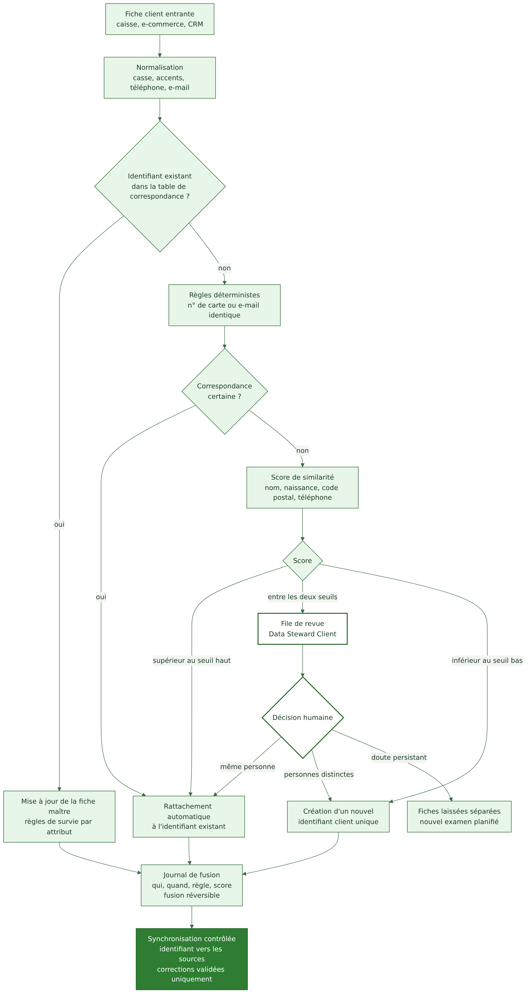

# Référentiel client (MDM)

Responsable : Personne 1. Exigence : EX-01.

## Rôle du MDM

Le MDM (Master Data Management) maintient une fiche maître par personne, identifiée par un identifiant client unique, et conserve la correspondance avec les identifiants des systèmes sources (carte fidélité, compte e-commerce, identifiant CRM). Il ne remplace pas le CRM : il fournit l'identité de référence, et le CRM reste l'outil de relation client.

## Pourquoi un MDM plutôt qu'une simple déduplication dans le Warehouse

Une déduplication faite uniquement dans le Warehouse corrige les rapports mais pas les systèmes sources : les doublons y reviennent. Le MDM crée un point de décision unique, traçable et réversible, et diffuse l'identifiant vers les sources.

## Règles de rapprochement

Voir le [diagramme du processus](../diagrammes/03-mdm-rapprochement.png).

1. Normalisation : casse, accents, espaces, format du téléphone, e-mail en minuscules.
2. Règles déterministes : même numéro de carte de fidélité, ou même e-mail normalisé vérifié, rattachent automatiquement.
3. Score de similarité sur nom, prénom, date de naissance, code postal, téléphone. Les seuils (haut et bas) sont des hypothèses à calibrer sur un échantillon réel ; nous ne les fixons pas arbitrairement.
4. Zone intermédiaire : revue humaine par le Data Steward Client.
5. Cas non tranchés : fiches laissées séparées. Un faux rapprochement (fusionner deux personnes) est plus grave qu'un doublon résiduel, car il expose les données d'une personne à une autre.

## Gestion des conflits (survie des attributs)

| Attribut | Règle proposée |
|---|---|
| Adresse, téléphone | valeur la plus récente validée |
| E-mail | e-mail vérifié (confirmation) prioritaire |
| Consentement marketing | la situation la plus restrictive prévaut tant que le statut n'est pas clarifié |
| Date de naissance | source de confiance la plus élevée, sinon revue |
| Points de fidélité | agrégés après fusion, contrôle par le CRM |

## Fusion réversible et traçabilité

Chaque fusion est journalisée (qui, quand, règle ou score, fiches concernées) et peut être défaite si une erreur est détectée.

## Synchronisation avec les sources

Le MDM diffuse l'identifiant unique vers les sources. Les corrections de données ne sont renvoyées qu'après validation (flèche en pointillé du schéma global). Le Warehouse ne renvoie jamais de données vers les sources.

## Indicateurs de suivi

Taux de doublons résiduels estimés, nombre de fiches en revue, délai de traitement de la file de revue, taux de fusions annulées (voir [qualité des données](qualite-donnees.md)).
